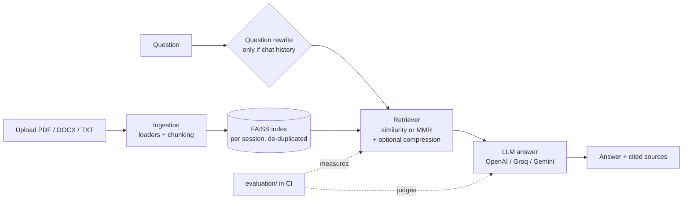

# DocuFlow

[](https://github.com/innovatewithfaizan/DocuFlow/actions/workflows/ci.yml)
[](https://github.com/innovatewithfaizan/DocuFlow/actions/workflows/evaluation.yml)

**A modular retrieval-augmented generation (RAG) service for asking questions about your documents, comparing PDFs and extracting metadata.** It runs on FastAPI, LangChain (LCEL) and FAISS, and you can swap between OpenAI, Groq and Gemini in one config file.

Every answer cites its sources (file, and page for PDFs), and retrieval quality is measured with an evaluation that runs in CI.

<!-- Demo: record upload -> index -> question -> cited answer, save as docs/demo.gif, then uncomment: -->
<!--  -->
> 🎬 **Demo GIF coming soon:** upload a PDF, build the index, ask a question, get a cited answer.

---

## Results

Measured on *Attention Is All You Need* (15 pages, 52 chunks) with 25 hand-written factual questions. Each question has a reference answer and evidence phrases taken verbatim from the paper. The evaluation goes through the app's own ingestion and retrieval code. The method and its limits are in [evaluation/README.md](evaluation/README.md), and every per-question result is in [evaluation/results/](evaluation/results/).

**Retrieval.** Is the evidence in the top 5 passages?

| Retriever | Hit rate | MRR | Context sent to the LLM |
|---|---|---|---|
| **Similarity (default)** | **22/25 (88%)** | **0.76** | 4,492 chars |
| MMR | 19/25 (76%) | 0.71 | 4,411 chars |
| Similarity + compression | 21/25 (84%) | 0.70 | 2,604 chars (**−42%**) |
| MMR + compression | 19/25 (76%) | 0.68 | 2,606 chars |

<sub>Local `BAAI/bge-small-en-v1.5` embeddings, 1,000-character chunks with 200 overlap, k=5. The evidence for every question sits inside a single chunk, so 25/25 is reachable. CI (Linux, Python 3.10) and a local run (macOS, Python 3.11) gave identical per-question results.</sub>

**Answers.** Faithfulness (the share of each answer's claims supported by the retrieved context) and correctness are scored by a separate LLM judge: `gpt-4.1` judges `gpt-4o` answers. The scoring is implemented and unit-tested but **not yet measured**, because it needs an OpenAI key (about US$0.25 per run). See [how to run it](evaluation/README.md#running-it).

**What the numbers say:**

- **Plain similarity found the evidence most often, so it's the default.** On single-fact questions, MMR's push for diversity cost 3 questions. It stays available per request for broad questions.
- **Compression cuts the context the LLM reads by 42% while keeping 21 of the 22 hits.** It's a cheap way to save tokens when that matters more than the last hit, so it's opt-in.
- **Every retriever misses the same 3 questions** (beam-search settings, checkpoint averaging, why self-attention parallelises). That points to a reranker or hybrid keyword + vector search as the next retrieval improvement, which the evaluation can now measure.

---

## What I built

- **A modular RAG pipeline.** Ingestion, chunking, indexing, retrieval and generation are separate modules behind a FastAPI service, with a small UI. Uploads are isolated per session in their own FAISS index. Re-uploading a document is de-duplicated by content hash, so the index never holds the same chunk twice.
- **A conversational chain in LangChain LCEL.** Follow-up questions are rewritten into standalone questions using the chat history. A first question skips that step, which saves one LLM call per query. Each answer comes back with its source file, page and passage.
- **Configurable retrieval.** Similarity or **MMR** (Maximal Marginal Relevance), plus optional **contextual compression**: retrieved chunks are split into pieces, near-duplicates are dropped, and only the pieces closest to the question are kept. All of it is set in `config.yaml` or per request. Compression uses embeddings only, so it adds no LLM calls.
- **An evaluation in CI.** 25 questions over a public paper, run through the app's own ingestion and retrieval code. Retrieval hit rate and MRR are recomputed on every PR that touches the evaluation, with local embeddings, so it needs no secrets and costs nothing. An LLM-as-judge step for answer faithfulness and correctness runs on demand. The evaluation is how I chose similarity over MMR as the default.
- **An offline test suite.** 75 pytest tests run with no network and no API keys. A deterministic bag-of-words embedding makes retrieval assertions meaningful, and a recording chat model lets tests check exactly what context reached the LLM. Each bug fix has a regression test that fails on the old code.
- **Swappable providers.** OpenAI, Groq or Gemini for the LLM; OpenAI, Gemini or a local ONNX model (bge-small) for embeddings. Only the keys of the providers in use are required.
- **Deployment.** A Docker image (non-root, cached dependency layer, no secrets inside) and a GitHub Actions workflow for AWS ECS Fargate that you trigger manually. Keys are injected at runtime from AWS Secrets Manager. CloudFormation for the VPC, ECR and ECS is in `infrastructure/`.

---

## Architecture



| Endpoint | What it does |
|---|---|
| `GET /health` | Liveness check |
| `POST /chat/index` | Upload files and build or extend a session index. Returns `session_id` and counts of documents, chunks and added chunks |
| `POST /chat/query` | Ask a question. Optional `k`, `search_type` (`similarity` or `mmr`) and `compress`. Returns the answer and its `sources` |
| `POST /analyze` | Structured metadata for a PDF: title, authors, summary, sentiment and more |
| `POST /compare` | Page-by-page differences between two PDFs |

---

## Quickstart

```bash
git clone https://github.com/innovatewithfaizan/DocuFlow.git
cd DocuFlow
python -m venv .venv && source .venv/bin/activate
pip install -r requirements.txt

cp .env.example .env        # add the key for the provider you use
uvicorn api.main:app --reload --port 8080
# open http://localhost:8080
```

```bash
# Index a document, then ask about it
curl -F "files=@paper.pdf" http://localhost:8080/chat/index
curl -F "question=What optimizer was used?" -F "session_id=<id from above>" http://localhost:8080/chat/query
```

**Configuration.** [`config/config.yaml`](config/config.yaml) sets the models and the retriever. Two environment variables override it per process:

| Variable | Values | Default |
|---|---|---|
| `LLM_PROVIDER` | `openai`, `groq`, `google` | `default_llm` in config.yaml |
| `EMBEDDING_PROVIDER` | `openai`, `google`, `fastembed` (local, no key) | the `embedding_model` setting in config.yaml |

An index has to be queried with the embedding model it was built with.

## Tests and evaluation

```bash
pip install -r requirements-dev.txt
pytest -q                                   # 75 tests, offline

pip install -r evaluation/requirements.txt
python -m evaluation.run_eval --embeddings fastembed --retrieval-only   # ~20 s, no API key
```

## Deployment

```bash
docker build -t docuflow . && docker run -p 8080:8080 --env-file .env docuflow
```

[`.github/workflows/aws.yaml`](.github/workflows/aws.yaml) builds the image, pushes it to ECR and deploys to ECS Fargate. The steps are preflight checks → tests → build → deploy, and the workflow runs **only when triggered manually** from the Actions tab. It needs `AWS_ACCESS_KEY_ID` and `AWS_SECRET_ACCESS_KEY` repository secrets. In ECS, an `API_KEYS` JSON secret is expanded into the individual provider keys at startup.

> **Status:** not currently deployed. The last automatic deploy (October 2025) failed because the repository had no AWS credentials configured, and the pipeline has since been fixed and made manual.

## Project structure

```
api/main.py                     FastAPI app and endpoints
src/document_ingestion/         file saving, loading, chunking, FAISS manager
src/document_chat/              ConversationalRAG chain, retriever factory (similarity / MMR / compression)
src/document_analyzer/          metadata extraction
src/document_compare/           PDF comparison
utils/                          model loader (providers), config, file I/O
prompt/  model/                 prompt templates, Pydantic schemas
evaluation/                     QA set, harness, metrics, committed results
tests/                          offline pytest suite
templates/  static/             web UI
infrastructure/                 CloudFormation (VPC, ECR, ECS)
.github/workflows/              tests, evaluation, manual ECS deploy
```

## Limitations and next steps

- Chat is stateless across requests: the API doesn't keep conversation history yet, although the chain supports it.
- There is no authentication. Session ids act as unguessable handles. FAISS indexes are loaded with pickle, which is only safe because the service reads indexes it wrote itself.
- The evaluation covers single-fact questions on one document (small N: one question is 4 points). Multi-document and broad questions, where MMR and compression should help, are the next things to add, along with the answer-faithfulness run.
- The AWS resource names still follow an older naming scheme, and the CloudFormation template needs reconciling with the deploy workflow.

## Tech stack

FastAPI · LangChain (LCEL) · FAISS · OpenAI / Groq / Gemini · FastEmbed · PyMuPDF / pypdf · structlog · pytest · Docker · GitHub Actions · AWS ECS Fargate, ECR, Secrets Manager, CloudFormation
