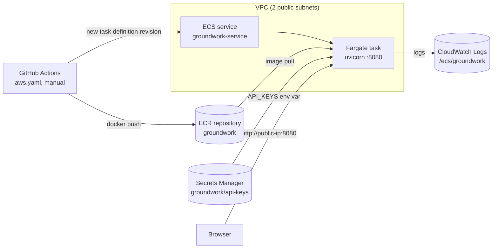

# Hosting Groundwork on AWS

This guide runs Groundwork as a single container on **AWS ECS Fargate**: serverless containers, with no EC2 instances to manage. After the one-time setup, every deploy is one click in GitHub Actions.

> **Status:** the setup is written and the template is validated with `cfn-lint`, but the app is **not currently deployed**.

## What gets created



| Piece | Created by | Notes |
|---|---|---|
| ECR repository `groundwork` | you, step 2 | Created before the stack, because the stack needs an image to start |
| Secret `groundwork/api-keys` | you, step 1 | One JSON object with the provider keys you use |
| VPC, subnets, security group, ECS cluster, service, task definition, log group, execution role | [`infrastructure/groundwork-ecs.yaml`](../infrastructure/groundwork-ecs.yaml), step 3 | Every name is prefixed `groundwork-`, and no account ids or regions are hard-coded |
| Deploy user for GitHub Actions | you, step 5 | Least-privilege policy in [`iam-deploy-policy.json`](iam-deploy-policy.json) |

**What it costs (approximate, check the [AWS Pricing Calculator](https://calculator.aws/)).** Defaults are one task with 0.5 vCPU and 1 GB running around the clock:

| Item | Approximate monthly cost |
|---|---|
| Fargate compute | about US$20 |
| Public IPv4 address for the task | about US$3.60 |
| Secrets Manager secret | US$0.40 |
| CloudWatch Logs and ECR storage | a few cents |

Setting the task count to 0 (see [Operating it](#operating-it)) stops the compute and IP charges without deleting anything.

## Prerequisites

- An AWS account, with the [AWS CLI v2](https://docs.aws.amazon.com/cli/latest/userguide/getting-started-install.html) configured (`aws configure`) for a user that can create the resources above.
- Docker.
- The GitHub CLI (`gh`), for step 5.
- An API key for at least one LLM provider (OpenAI by default).

Run every command from the repository root:

```bash
export AWS_REGION=ca-central-1        # any region with Fargate
export ACCOUNT_ID=$(aws sts get-caller-identity --query Account --output text)
export REGISTRY=$ACCOUNT_ID.dkr.ecr.$AWS_REGION.amazonaws.com
```

## 1. Store the API keys in Secrets Manager

The container receives this secret as one environment variable, `API_KEYS`, and the app expands it into `OPENAI_API_KEY`, `GROQ_API_KEY` and so on at startup (see `utils/model_loader.py`).

Put only the keys you use into a file. Write it in an editor rather than on the command line, so the key doesn't end up in your shell history:

```json
{"OPENAI_API_KEY": "sk-..."}
```

```bash
SECRET_ARN=$(aws secretsmanager create-secret --name groundwork/api-keys \
  --secret-string file://keys.json --query ARN --output text)
rm keys.json
```

## 2. Create the ECR repository and push the first image

```bash
aws ecr create-repository --repository-name groundwork \
  --image-scanning-configuration scanOnPush=true

aws ecr get-login-password | docker login --username AWS --password-stdin $REGISTRY

# --platform matters on Apple Silicon: Fargate runs this task on x86_64
docker build --platform linux/amd64 -t $REGISTRY/groundwork:v1 .
docker push $REGISTRY/groundwork:v1
```

## 3. Create the stack

```bash
aws cloudformation deploy \
  --stack-name groundwork \
  --template-file infrastructure/groundwork-ecs.yaml \
  --capabilities CAPABILITY_IAM \
  --parameter-overrides \
      ImageUri=$REGISTRY/groundwork:v1 \
      ApiKeysSecretArn=$SECRET_ARN \
      AllowedCidr=$(curl -s https://checkip.amazonaws.com)/32
```

`AllowedCidr` restricts port 8080 to your own IP. Use `0.0.0.0/0` for a public demo.

Other parameters:

| Parameter | Default | What it sets |
|---|---|---|
| `LlmProvider` | `openai` | LLM provider |
| `EmbeddingProvider` | `openai` | Embedding provider |
| `TaskCpu` | `512` | CPU units |
| `TaskMemory` | `1024` | Memory in MB |
| `DesiredCount` | `1` | Number of running tasks |
| `LogRetentionDays` | `14` | How long logs are kept |

The stack takes a few minutes. The service waits until the container passes its `/health` check.

## 4. Open the app

The task gets a public IP. There's no load balancer; see [Hardening for production](#hardening-for-production).

```bash
TASK_ARN=$(aws ecs list-tasks --cluster groundwork-cluster --service-name groundwork-service \
  --query 'taskArns[0]' --output text)
ENI_ID=$(aws ecs describe-tasks --cluster groundwork-cluster --tasks $TASK_ARN \
  --query "tasks[0].attachments[0].details[?name=='networkInterfaceId'].value" --output text)
PUBLIC_IP=$(aws ec2 describe-network-interfaces --network-interface-ids $ENI_ID \
  --query 'NetworkInterfaces[0].Association.PublicIp' --output text)

curl http://$PUBLIC_IP:8080/health      # {"status":"ok","service":"groundwork"}
echo "Open http://$PUBLIC_IP:8080"
```

The IP changes whenever the task is replaced, for example after a deploy or a restart.

## 5. Deploy from GitHub Actions

[`.github/workflows/aws.yaml`](../.github/workflows/aws.yaml) runs only when you start it. The steps are:

1. A preflight check.
2. The test suite.
3. Build the image and push it to ECR, tagged with the commit SHA.
4. Read the current task definition from ECS, swap in the new image, and deploy.
5. Wait for the service to become stable. If the new task is unhealthy, the stack's deployment circuit breaker rolls back.

It needs an AWS identity that can do only those things:

```bash
ROLE_ARN=$(aws cloudformation describe-stacks --stack-name groundwork \
  --query "Stacks[0].Outputs[?OutputKey=='TaskExecutionRoleArn'].OutputValue" --output text)

sed -e "s/REGION/$AWS_REGION/g" -e "s/ACCOUNT_ID/$ACCOUNT_ID/g" -e "s#TASK_EXECUTION_ROLE_ARN#$ROLE_ARN#" \
  docs/iam-deploy-policy.json > deploy-policy.json

aws iam create-user --user-name groundwork-deployer
aws iam put-user-policy --user-name groundwork-deployer --policy-name groundwork-deploy \
  --policy-document file://deploy-policy.json
rm deploy-policy.json
aws iam create-access-key --user-name groundwork-deployer   # shows the secret key once
```

Store the key pair as repository secrets, set the region, then run the workflow:

```bash
gh secret set AWS_ACCESS_KEY_ID          # paste when prompted
gh secret set AWS_SECRET_ACCESS_KEY
gh variable set AWS_REGION --body "$AWS_REGION"

gh workflow run aws.yaml --ref main      # or: Actions → Deploy to ECS Fargate → Run workflow
```

Long-lived access keys are the simplest option. The better one is [GitHub OIDC](https://docs.github.com/en/actions/security-for-github-actions/security-hardening-your-deployments/configuring-openid-connect-in-amazon-web-services): an IAM role that only this repository's `main` branch can assume, so no keys are stored at all.

## Operating it

```bash
# Stream logs
aws logs tail /ecs/groundwork --follow

# Pause (stops compute and public-IP charges), then resume
aws ecs update-service --cluster groundwork-cluster --service groundwork-service --desired-count 0
aws ecs update-service --cluster groundwork-cluster --service groundwork-service --desired-count 1
```

**Updating the stack after GitHub deploys.** The workflow registers new task-definition revisions outside CloudFormation. When you re-run `aws cloudformation deploy` later, for example to change CPU, pass the image that's currently live (`ImageUri=$REGISTRY/groundwork:<latest sha>`). Otherwise the stack rolls the service back to the image it last knew about.

**Tearing it all down:**

```bash
aws cloudformation delete-stack --stack-name groundwork
aws ecr delete-repository --repository-name groundwork --force
aws secretsmanager delete-secret --secret-id groundwork/api-keys --recovery-window-in-days 7
# deploy user: delete its access keys and inline policy first, then the user
```

## Hardening for production

This setup is sized for a portfolio demo. Before real users, add:

| Gap | Fix |
|---|---|
| HTTP only, and the IP changes on every deploy | An Application Load Balancer, with an ACM certificate for HTTPS and a Route 53 domain. Adds the ALB's hourly cost. |
| Uploads and FAISS indexes live on the task's temporary disk and **are lost on every restart or deploy** | Mount EFS at `/app/data` and `/app/faiss_index`, or store indexes in S3. |
| No authentication | Cognito or OIDC on the load balancer, or an API-key check in FastAPI. |
| One task, no autoscaling | ECS service autoscaling on CPU or request count, behind the ALB. |
| Long-lived deploy keys | The GitHub OIDC role mentioned in step 5. |

## Troubleshooting

| Symptom | Likely cause |
|---|---|
| Actions: *Credentials could not be loaded… from any providers* | The `AWS_ACCESS_KEY_ID` / `AWS_SECRET_ACCESS_KEY` repository secrets are missing. This is what broke the October 2025 deploy; the preflight job now names the missing secret. |
| Task stops with `CannotPullContainerError` | The image URI or tag is wrong, or the image is in a different region from the stack. |
| Task stops with `ResourceInitializationError … secret` | `ApiKeysSecretArn` is wrong or in another region. The execution role can only read that one secret. |
| `exec format error` in the logs | The image was built for arm64 (Apple Silicon). Rebuild with `--platform linux/amd64`. |
| `/health` works but questions fail with *Missing environment variable OPENAI_API_KEY* | The secret's JSON doesn't contain the key for `LlmProvider` / `EmbeddingProvider`. |
| Deploy waits, then rolls back | The new container failed its health check. Check `aws logs tail /ecs/groundwork`. |
